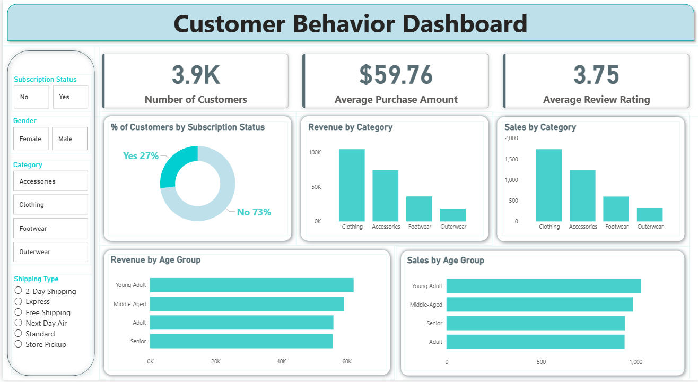

# 🛍️ Retail Customer Insights & Analytics

[](https://www.python.org/)
[](https://www.postgresql.org/)
[](https://powerbi.microsoft.com/)
[](LICENSE)
[](https://github.com/1Nilesh0837)

---

## 📌 Project Overview

**Retail Customer Insights & Analytics** is an end-to-end data analytics project that transforms raw retail transaction records into strategic business intelligence. The workflow spans **data cleaning and feature engineering in Python**, **complex business query analysis in SQL**, and **interactive executive reporting in Power BI**.

This project provides actionable insights into customer purchasing patterns, subscriber vs. non-subscriber behavior, age-group revenue contribution, discount sensitivity, and customer lifetime loyalty.

---

## 👤 Author Information

- **Name:** Nilesh Sahoo
- **Email:** [nileshsahoo837@gmail.com](mailto:nileshsahoo837@gmail.com)
- **GitHub:** [@1Nilesh0837](https://github.com/1Nilesh0837)
- **Repository:** [Retail-Customer-Insights-Analytics](https://github.com/1Nilesh0837/Retail-Customer-Insights-Analytics)

---

## 📂 Repository Structure

```plaintext
Retail-Customer-Insights-Analytics/
│
├── Dashboard_Preview/
│   └── Customer_Behavior_Dashboard.png    # High-resolution Power BI dashboard preview
│
├── Business Problem  Document.pdf         # Problem framing & business objectives
├── Customer Behavior Analysis.pdf         # Comprehensive project documentation & findings
├── Customer-Shopping-Behavior-Analysis.pptx# Executive presentation slide deck
│
├── customer_behavior_analysis.ipynb       # Python EDA, cleaning & feature engineering
├── customer_behavior_analysis.sql         # 10 Business analytics SQL queries
├── customer_behavior_dashboard.pbix       # Interactive Power BI report file
├── customer_shopping_behavior.csv         # Cleaned transaction dataset (3,900 rows)
│
├── requirements.txt                       # Python dependencies
├── .gitignore                             # Ignored cache, checkpoints & local files
├── LICENSE                                # MIT License
└── README.md                              # Project documentation
```

---

## 📊 Dataset Details

The dataset records **3,900 customer transactions** across 18 behavioral and demographic attributes:

| Feature Category | Key Attributes |
| :--- | :--- |
| **Customer Profile** | `Customer ID`, `Age`, `Gender`, `Location`, `Subscription Status` |
| **Transaction Details**| `Item Purchased`, `Category`, `Purchase Amount (USD)`, `Season` |
| **Purchase Behavior** | `Previous Purchases`, `Frequency of Purchases`, `Review Rating` |
| **Fulfillment & Promo**| `Shipping Type`, `Discount Applied`, `Promo Code Used`, `Payment Method` |

---

## 🛠️ Tech Stack & Tools

- **Data Processing & EDA:** Python (`pandas`, `numpy`, `matplotlib`, `seaborn`)
- **Relational Database Analysis:** SQL (`PostgreSQL`, `MySQL`)
- **Business Intelligence & Visualization:** Microsoft Power BI
- **Documentation & Reporting:** MS Word / PDF, PowerPoint

---

## 📸 Interactive Power BI Dashboard Preview

The executive dashboard provides dynamic filtering across **Product Category**, **Customer Demographics**, **Subscription Status**, and **Shipping Channels**.



### Key Dashboard KPIs:
- **Total Revenue & Average Spend** per order
- **Demographic Breakdown** (Revenue contribution across age groups & gender)
- **Product Category Performance** (Clothing, Footwear, Outerwear, Accessories)
- **Subscription Analysis** (Revenue contribution from active subscribers vs non-subscribers)
- **Shipping & Fulfillment Comparison** (Express vs Standard delivery spend)

---

## 🔍 Key SQL Queries & Business Insights

The project investigates **10 critical business questions** in `customer_behavior_analysis.sql`:

1. **Revenue by Gender:** Analyzes purchasing distribution between male and female shoppers.
2. **Above-Average Discount Spenders:** Identifies high-value customers who took advantage of promotions.
3. **Top 5 Rated Products:** Determines highest-satisfaction items by average customer review rating.
4. **Shipping Method Spend:** Compares average basket size between Standard and Express shipping.
5. **Subscription Financial Impact:** Compares average transaction amount and total revenue from subscribers vs non-subscribers.
6. **Discount Sensitivity:** Pinpoints items with the highest promo usage percentage.
7. **Customer Loyalty Segmentation:** Classifies customers into **New**, **Returning**, and **Loyal** segments using purchase count thresholds.
8. **Top 3 Products by Category:** Ranks top items per retail department using SQL window functions (`ROW_NUMBER() OVER PARTITION BY`).
9. **Repeat Buyer Subscription Likelihood:** Evaluates subscription conversion rates among repeat shoppers (>5 purchases).
10. **Age Group Revenue Contribution:** Aggregates overall sales by demographic age tiers.

---

## 🚀 How to Run & Replicate This Project

### 1. Clone the Repository
```bash
git clone https://github.com/1Nilesh0837/Retail-Customer-Insights-Analytics.git
cd Retail-Customer-Insights-Analytics
```

### 2. Set Up Python Environment & Install Dependencies
```bash
python -m venv venv
# Windows:
venv\Scripts\activate
# Linux/macOS:
# source venv/bin/activate

pip install -r requirements.txt
```

### 3. Run Exploratory Data Analysis (EDA)
Launch Jupyter Notebook or open in VS Code:
```bash
jupyter notebook customer_behavior_analysis.ipynb
```

### 4. Execute SQL Queries
1. Create a database in PostgreSQL or MySQL:
   ```sql
   CREATE DATABASE retail_insights;
   ```
2. Import `customer_shopping_behavior.csv` into a table named `customer_data`.
3. Open and run [`customer_behavior_analysis.sql`](customer_behavior_analysis.sql).

### 5. Explore the Power BI Dashboard
- Open [`customer_behavior_dashboard.pbix`](customer_behavior_dashboard.pbix) using [Power BI Desktop](https://powerbi.microsoft.com/desktop/).
- Verify or refresh data source connections if linking to your local SQL instance.

---

## 📈 Strategic Business Recommendations

- **Targeted Loyalty Programs:** Leverage the findings that loyal repeat shoppers (>5 orders) have a higher propensity to subscribe by triggering tailored subscription offers after purchase #3.
- **Optimize Discounting on Elastic Products:** Restrict heavy discount campaigns on categories that already demonstrate steady full-price purchasing velocity.
- **Incentivize Express Shipping:** High-value carts correlate with express delivery; offer tiered free express shipping for cart totals exceeding threshold values.

---

## 📜 License

This project is open-source and available under the [MIT License](LICENSE).

---

## 📬 Contact & Connect

**Nilesh Sahoo**  
- **Email:** [nileshsahoo837@gmail.com](mailto:nileshsahoo837@gmail.com)  
- **GitHub:** [@1Nilesh0837](https://github.com/1Nilesh0837)  
- **Project Repo:** [Retail-Customer-Insights-Analytics](https://github.com/1Nilesh0837/Retail-Customer-Insights-Analytics)
